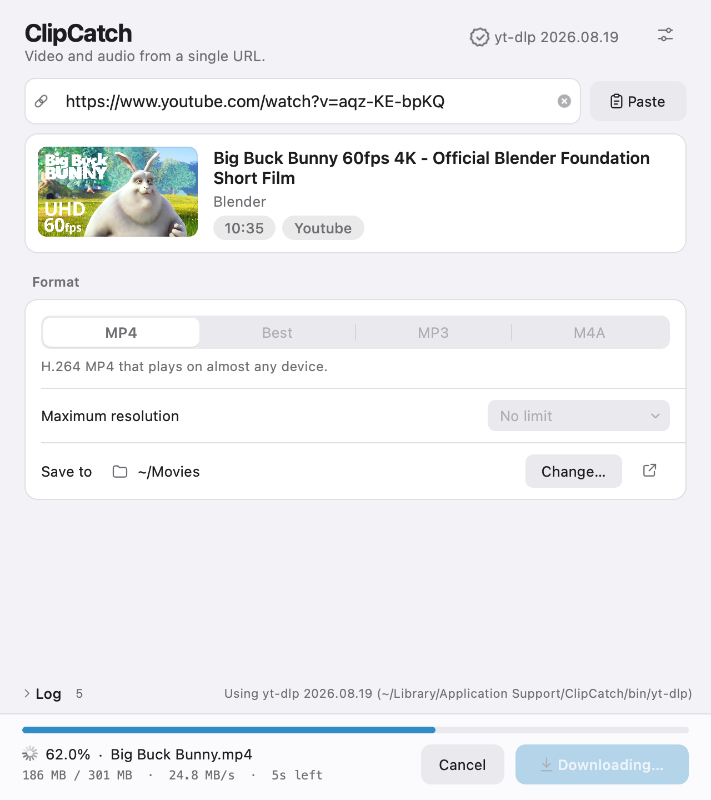

<p align="center">
  
</p>

<h1 align="center">ClipCatch</h1>

<p align="center">
  Save video and audio just by pasting a URL.<br>
  A desktop app for macOS and Windows.
</p>

<p align="center">
  <a href="https://github.com/myuto2490/ClipCatch/releases/latest"></a>
  <a href="https://github.com/myuto2490/ClipCatch/actions/workflows/ci.yml"></a>
  
  <a href="LICENSE"></a>
</p>

<p align="center">English | <a href="README.md">日本語</a></p>

<p align="center">
  <picture>
    <source media="(prefers-color-scheme: dark)" srcset="docs/screenshot-en-dark.png">
    
  </picture>
</p>

## Features

- **See what you'll get first** — paste a URL and a card shows the thumbnail, title, uploader and duration
- **Zero setup** — [yt-dlp](https://github.com/yt-dlp/yt-dlp), ffmpeg and Deno are downloaded from their official releases on first launch. No Python or other installs needed
- **Verified downloads** — yt-dlp is checked against its official SHA-256 checksums before use
- **Clear progress** — percentage, size, speed, time left, and post-processing steps (merging, converting)
- **Catches broken files** — after saving, ClipCatch checks the video track and warns you if it ends early
- **Faster downloads** — uses [aria2](https://aria2.github.io) for parallel connections when available (great for bilibili)
- **Same experience on macOS and Windows** — designed after Apple's [Human Interface Guidelines](https://developer.apple.com/design/human-interface-guidelines/); follows your system's light/dark mode and accent color
- **English and Japanese** — matches your system language

## Download

Pick the file for your computer from [**Releases**](https://github.com/myuto2490/ClipCatch/releases/latest).

| Platform | File |
| --- | --- |
| macOS (Apple silicon) | `ClipCatch-<version>-macOS-arm64.dmg` |
| macOS (Intel) | `ClipCatch-<version>-macOS-x64.dmg` |
| Windows (installer) | `ClipCatch-<version>-Windows-x64-Setup.exe` |
| Windows (portable) | `ClipCatch-<version>-Windows-x64.zip` |

Use `SHA256SUMS.txt` to verify your download.

### Requirements

- macOS 12 Monterey or later
- Windows 10 (64-bit) or later

### Opening it the first time

Releases that aren't signed with an Apple or Microsoft code-signing certificate show a one-time warning.

**macOS** — if macOS says the app can't be opened, go to **System Settings › Privacy & Security** and click
**Open Anyway**. Alternatively, run:

```sh
xattr -dr com.apple.quarantine /Applications/ClipCatch.app
```

**Windows** — if you see "Windows protected your PC", click **More info** › **Run anyway**.

## Usage

1. Copy the URL of a video page and switch to ClipCatch (a copied URL is filled in automatically)
   - You can also drag a link onto the window
2. Choose a format and maximum resolution
3. Click **Download**

| Format | Description |
| --- | --- |
| MP4 | H.264 MP4 that plays on almost any device |
| Best | The best video and audio the site offers (may be VP9 or AV1) |
| MP3 | Audio only, converted to MP3 (192 kbps) |
| M4A | Audio only, saved as-is without re-encoding (fastest) |

### Keyboard shortcuts

| Action | macOS | Windows |
| --- | --- | --- |
| Start download | <kbd>⌘</kbd><kbd>↩</kbd> | <kbd>Ctrl</kbd>+<kbd>Enter</kbd> |
| Cancel | <kbd>⌘</kbd><kbd>.</kbd> / <kbd>esc</kbd> | <kbd>Ctrl</kbd>+<kbd>.</kbd> / <kbd>Esc</kbd> |
| Focus the URL field | <kbd>⌘</kbd><kbd>L</kbd> | <kbd>Ctrl</kbd>+<kbd>L</kbd> |
| Paste from clipboard | <kbd>⇧</kbd><kbd>⌘</kbd><kbd>V</kbd> | <kbd>Ctrl</kbd>+<kbd>Shift</kbd>+<kbd>V</kbd> |
| Show the saved file | <kbd>⇧</kbd><kbd>⌘</kbd><kbd>O</kbd> | <kbd>Ctrl</kbd>+<kbd>Shift</kbd>+<kbd>O</kbd> |
| Settings | <kbd>⌘</kbd><kbd>,</kbd> | <kbd>Ctrl</kbd>+<kbd>,</kbd> |

## Keeping yt-dlp up to date

Sites like YouTube change often, so **yt-dlp needs regular updates**. You can update it without reinstalling ClipCatch:

- ClipCatch checks for a new yt-dlp at launch and shows **Update** in the top-right corner when one is available
- Choose **Update to the Latest Version** in that menu, or **Update Now** in Settings (no restart needed)

## Tools and where they live

ClipCatch doesn't bundle these tools; it downloads the official builds on first launch.
If a tool is already installed (Homebrew, winget, Scoop, …), ClipCatch uses that one.

| Tool | Purpose | Source |
| --- | --- | --- |
| yt-dlp | Extracting and downloading media | [yt-dlp releases](https://github.com/yt-dlp/yt-dlp/releases) |
| ffmpeg / ffprobe | Merging, MP3 conversion, integrity checks | macOS: [Martin Riedl's builds](https://ffmpeg.martin-riedl.de) / Windows: [yt-dlp/FFmpeg-Builds](https://github.com/yt-dlp/FFmpeg-Builds) |
| Deno | JavaScript runtime yt-dlp uses for YouTube | [Deno releases](https://github.com/denoland/deno/releases) |
| aria2c (optional) | Parallel connections | macOS: Homebrew / Windows: [aria2 releases](https://github.com/aria2/aria2/releases) |

| OS | Location |
| --- | --- |
| macOS | `~/Library/Application Support/ClipCatch/bin/` |
| Windows | `%LOCALAPPDATA%\ClipCatch\bin\` |

### Uninstalling

- **macOS** — move `/Applications/ClipCatch.app` to the Trash, then delete
  `~/Library/Application Support/ClipCatch/` and `~/Library/Preferences/io.github.myuto2490.ClipCatch.plist`
- **Windows** — uninstall ClipCatch from **Settings › Apps**, then delete `%LOCALAPPDATA%\ClipCatch\`
  (settings are stored in the registry under `HKEY_CURRENT_USER\Software\ClipCatch`)

## Development

ClipCatch is written in Python 3.10+ with [Qt for Python (PySide6)](https://doc.qt.io/qtforpython-6/); the same
code runs on macOS and Windows. See the [Japanese README](README.md#開発) for build and release steps, and
[CONTRIBUTING.md](CONTRIBUTING.md) for how to contribute.

```sh
python3 -m venv .venv && source .venv/bin/activate   # Windows: .venv\Scripts\activate
pip install -e ".[dev]"
python -m clipcatch          # run
pytest                       # test
python packaging/build.py    # build a .dmg / installer for this OS
```

## Disclaimer

Use ClipCatch for personal purposes only. You are responsible for respecting copyright and the terms of
service of the sites you download from.

## License

[MIT License](LICENSE) © 2026 myuto2490

Licenses of the software ClipCatch bundles or downloads are listed in [THIRD_PARTY_NOTICES.md](THIRD_PARTY_NOTICES.md).
Release packages include the full license texts (such as LGPL-3.0 for Qt / PySide6); open them from **About ClipCatch › Open Source Licenses**.
The README screenshots show *Big Buck Bunny* by the Blender Foundation (CC BY 3.0).
