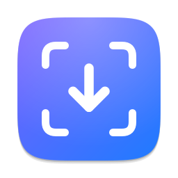
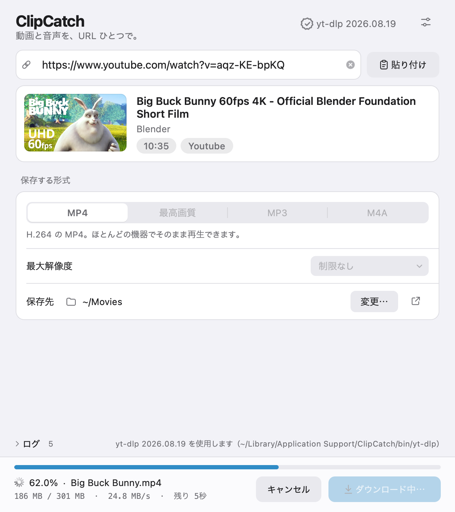

<p align="center">
  
</p>

<h1 align="center">ClipCatch</h1>

<p align="center">
  URL を貼るだけで、動画と音声を保存できるデスクトップアプリ。<br>
  macOS と Windows に対応しています。
</p>

<p align="center">
  <a href="https://github.com/myuto2490/ClipCatch/releases/latest"></a>
  <a href="https://github.com/myuto2490/ClipCatch/actions/workflows/ci.yml"></a>
  
  <a href="LICENSE"></a>
</p>

<p align="center"><a href="README.en.md">English</a> | 日本語</p>

<p align="center">
  <picture>
    <source media="(prefers-color-scheme: dark)" srcset="docs/screenshot-ja-dark.png">
    
  </picture>
</p>

## 特徴

- **貼る前に中身がわかる** — URL を入れると、サムネイル・タイトル・投稿者・再生時間をカードで表示します
- **準備は自動** — [yt-dlp](https://github.com/yt-dlp/yt-dlp)・ffmpeg・Deno を初回起動時に公式の配布物から取得します。Python などを別に入れる必要はありません
- **安全な取得** — yt-dlp は公式の SHA-256 チェックサムで検証してから使います
- **進行状況がわかる** — 進捗・転送量・速度・残り時間・後処理の段階（結合や変換）を表示します
- **壊れたファイルに気づける** — 保存後に映像の長さを検査し、途中で映像が途切れていれば知らせます
- **高速ダウンロード** — [aria2](https://aria2.github.io) があれば多重接続で取得します（bilibili などで効果大）
- **macOS と Windows で同じ操作感** — [Apple Human Interface Guidelines](https://developer.apple.com/jp/design/human-interface-guidelines/) を参考にしたデザイン。ライト／ダークとアクセントカラーは OS の設定に従います
- **日本語と英語** — OS の言語設定に合わせて切り替わります

## ダウンロード

[**Releases**](https://github.com/myuto2490/ClipCatch/releases/latest) から使っている環境のものを選んでください。

| 環境 | ファイル |
| --- | --- |
| macOS（Apple シリコン） | `ClipCatch-<バージョン>-macOS-arm64.dmg` |
| macOS（Intel） | `ClipCatch-<バージョン>-macOS-x64.dmg` |
| Windows（インストーラ） | `ClipCatch-<バージョン>-Windows-x64-Setup.exe` |
| Windows（ポータブル版） | `ClipCatch-<バージョン>-Windows-x64.zip` |

`SHA256SUMS.txt` で、ダウンロードしたファイルが改ざんされていないか確認できます。

### 動作環境

- macOS 12 Monterey 以降
- Windows 10（64 ビット）以降

### 初めて開くとき

Apple / Microsoft のコード署名証明書で署名していないリリースでは、初回だけ OS の確認が出ます。

**macOS** — 「開いていません」と表示されたら、**システム設定 › プライバシーとセキュリティ** の下にある
**「このまま開く」** を押してください。ターミナルで次を実行しても構いません。

```sh
xattr -dr com.apple.quarantine /Applications/ClipCatch.app
```

**Windows** — 「Windows によって PC が保護されました」と表示されたら、**詳細情報** › **実行** を押してください。

## 使い方

1. 動画のページの URL をコピーして ClipCatch を開く（クリップボードの URL が自動で入ります）
   - リンクをウインドウにドラッグ＆ドロップしても入力できます
2. 形式と最大解像度を選ぶ
3. **ダウンロード** を押す

| 形式 | 内容 |
| --- | --- |
| MP4 | H.264 の MP4。ほとんどの機器でそのまま再生できます |
| 最高画質 | サイトが配信する最良の映像と音声（VP9 / AV1 になることがあります） |
| MP3 | 音声だけを MP3（192 kbps）に変換 |
| M4A | 音声だけを変換せずそのまま保存（最速） |

### キーボードショートカット

| 操作 | macOS | Windows |
| --- | --- | --- |
| ダウンロード開始 | <kbd>⌘</kbd><kbd>↩</kbd> | <kbd>Ctrl</kbd>+<kbd>Enter</kbd> |
| キャンセル | <kbd>⌘</kbd><kbd>.</kbd> / <kbd>esc</kbd> | <kbd>Ctrl</kbd>+<kbd>.</kbd> / <kbd>Esc</kbd> |
| URL の入力欄へ移動 | <kbd>⌘</kbd><kbd>L</kbd> | <kbd>Ctrl</kbd>+<kbd>L</kbd> |
| クリップボードから貼り付け | <kbd>⇧</kbd><kbd>⌘</kbd><kbd>V</kbd> | <kbd>Ctrl</kbd>+<kbd>Shift</kbd>+<kbd>V</kbd> |
| 保存したファイルを表示 | <kbd>⇧</kbd><kbd>⌘</kbd><kbd>O</kbd> | <kbd>Ctrl</kbd>+<kbd>Shift</kbd>+<kbd>O</kbd> |
| 設定 | <kbd>⌘</kbd><kbd>,</kbd> | <kbd>Ctrl</kbd>+<kbd>,</kbd> |

### 設定

ウインドウ右上の設定ボタン（または上のショートカット）から開きます。

- 完了したら Finder / エクスプローラーで表示
- クリップボードの URL を自動で入力
- 完了を知らせる（別のアプリを使っているとき）
- aria2c で高速ダウンロード
- ブラウザの Cookie を使う（ログインが必要な動画や画質のため）
- プレイリストはすべて保存
- yt-dlp の個人設定ファイルを読み込む
- 新しいバージョンを確認

## yt-dlp の更新

YouTube などは仕様が頻繁に変わるため、**yt-dlp は定期的な更新が必要**です。ClipCatch を入れ直さなくても
yt-dlp だけを更新できます。

- 起動時に最新版を確認し、新しいものがあればウインドウ右上に **「更新あり」** と表示します
- 右上のメニューの **「最新版に更新」**、または設定の **「今すぐ更新」** で入れ替わります（再起動は不要）

## 使うツールと置き場所

ClipCatch 本体はツールを同梱せず、初回起動時に公式の配布物を取得します。
すでにパソコンに入っているもの（Homebrew・winget・Scoop など）が見つかれば、そちらを使います。

| ツール | 用途 | 取得元 |
| --- | --- | --- |
| yt-dlp | 動画の解析とダウンロード | [yt-dlp の GitHub リリース](https://github.com/yt-dlp/yt-dlp/releases) |
| ffmpeg / ffprobe | 映像と音声の結合・MP3 変換・検査 | macOS: [Martin Riedl のビルド](https://ffmpeg.martin-riedl.de) / Windows: [yt-dlp/FFmpeg-Builds](https://github.com/yt-dlp/FFmpeg-Builds) |
| Deno | YouTube の解析に使う JavaScript ランタイム | [Deno の GitHub リリース](https://github.com/denoland/deno/releases) |
| aria2c（任意） | 多重接続による高速化 | macOS: Homebrew / Windows: [aria2 の GitHub リリース](https://github.com/aria2/aria2/releases) |

取得したものは次の場所に置きます（アプリ本体は書き換えません）。

| OS | 場所 |
| --- | --- |
| macOS | `~/Library/Application Support/ClipCatch/bin/` |
| Windows | `%LOCALAPPDATA%\ClipCatch\bin\` |

### アンインストール

- **macOS** — `/Applications/ClipCatch.app` をゴミ箱に入れ、`~/Library/Application Support/ClipCatch/` と
  `~/Library/Preferences/io.github.myuto2490.ClipCatch.plist` を削除します
- **Windows** — 「設定 › アプリ」から ClipCatch をアンインストールし、`%LOCALAPPDATA%\ClipCatch\` を削除します
  （設定はレジストリの `HKEY_CURRENT_USER\Software\ClipCatch` にあります）

## 開発

Python 3.10 以降と [Qt for Python（PySide6）](https://doc.qt.io/qtforpython-6/) で書かれています。
macOS と Windows で同じソースを使います。

```sh
git clone https://github.com/myuto2490/ClipCatch.git
cd ClipCatch
python3 -m venv .venv
source .venv/bin/activate          # Windows: .venv\Scripts\activate
pip install -e ".[dev]"

python -m clipcatch                 # 起動
pytest                              # テスト
ruff check . && ruff format --check .
```

### 配布物を作る

```sh
python packaging/build.py --self-test
```

| OS | 出力 |
| --- | --- |
| macOS | `dist/ClipCatch.app`、`dist/ClipCatch-<バージョン>-macOS-<arch>.dmg` |
| Windows | `dist/ClipCatch/`、ポータブル版の `.zip`、[Inno Setup 6](https://jrsoftware.org/isinfo.php) があればインストーラ |

Developer ID で署名・公証する場合は `MACOS_SIGN_IDENTITY` と `MACOS_NOTARY_PROFILE` を設定します
（詳しくは [packaging/build.py](packaging/build.py) の冒頭）。

### リリース

1. `src/clipcatch/__init__.py` の `__version__` と [CHANGELOG.md](CHANGELOG.md) を更新する
2. `v<バージョン>` のタグを push する（例: `git tag v1.0.0 && git push origin v1.0.0`）
3. GitHub Actions が Apple シリコン・Intel・Windows 向けの配布物を作り、**下書きのリリース**に添付する
4. 内容を確認して公開する

GitHub の Secrets に次を登録すると、macOS 版が Developer ID で署名・公証されます（任意）。

| Secret | 内容 |
| --- | --- |
| `MACOS_CERTIFICATE` | Developer ID Application 証明書（.p12）を Base64 にしたもの |
| `MACOS_CERTIFICATE_PASSWORD` | .p12 のパスワード |
| `MACOS_SIGN_IDENTITY` | 例: `Developer ID Application: Your Name (TEAMID)` |
| `APPLE_ID` / `APPLE_TEAM_ID` / `APPLE_APP_PASSWORD` | 公証用の Apple ID・チーム ID・App 用パスワード |

### 構成

```
src/clipcatch/
├── app.py              QApplication の組み立て
├── controller.py       画面の状態と操作（ビューはここだけを見る）
├── core/               Qt に依存しない処理（単体テストの対象）
│   ├── ytdlp.py        yt-dlp の引数の組み立てと出力の解釈
│   ├── formats.py      形式・解像度・Cookie
│   ├── sources.py      各ツールの公式配布物の場所
│   ├── platform.py     OS ごとの差
│   └── …
├── services/           Qt を使う処理（プロセス・通信・設定・ツールの準備）
└── ui/                 画面（配色・独自描画の部品・各ウインドウ）
packaging/              PyInstaller の設定・ビルドスクリプト・インストーラ
tools/                  アイコンとスクリーンショットの生成
tests/
```

開発への参加は [CONTRIBUTING.md](CONTRIBUTING.md) をご覧ください。

## 免責事項

ClipCatch は私的利用の範囲でお使いください。ダウンロードするコンテンツの権利や各サービスの利用規約は、
利用者自身の責任で確認してください。著作権を侵害する目的での利用はお控えください。

## ライセンス

[MIT License](LICENSE) © 2026 myuto2490

ClipCatch が利用・取得するソフトウェアのライセンスは [THIRD_PARTY_NOTICES.md](THIRD_PARTY_NOTICES.md) にまとめています。
README のスクリーンショットには Blender Foundation の『Big Buck Bunny』（CC BY 3.0）を使用しています。
